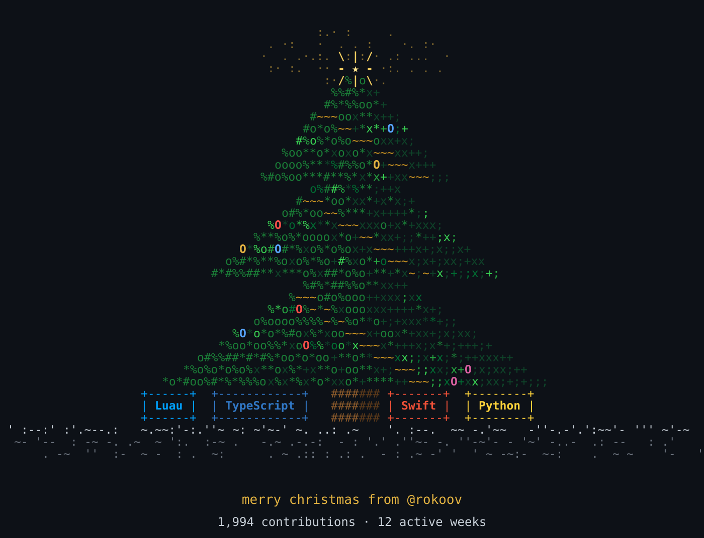
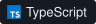
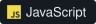
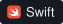
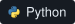
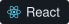
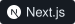
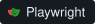
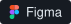
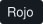

<table width="100%">
<tr><td>

</td></tr>
<tr><td>

**languages** 
    

</td></tr>
<tr><td>

**frontend** 
     

</td></tr>
<tr><td>

**agents / ai** 
 

</td></tr>
<tr><td>

**infra** 
   

</td></tr>
</table>
